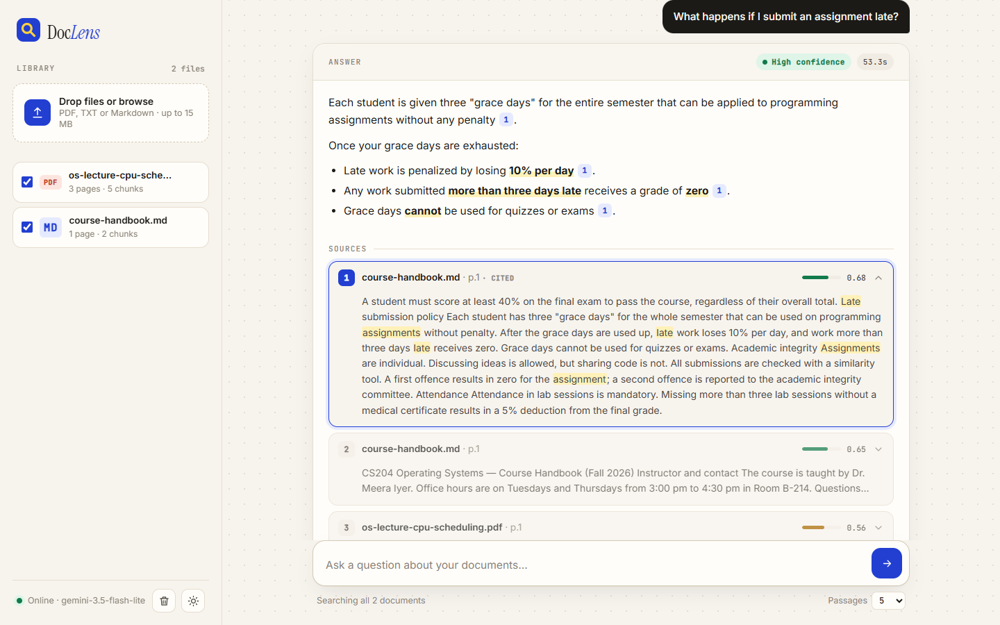
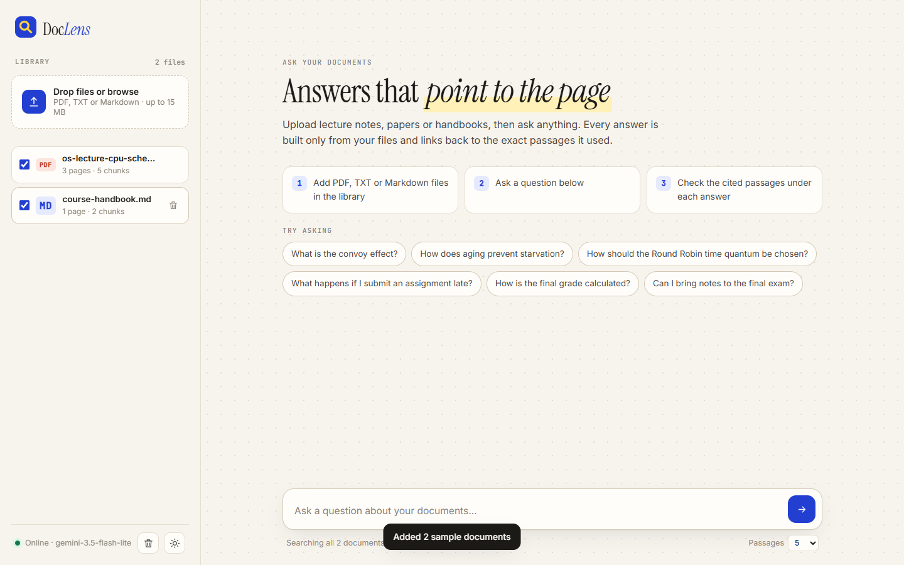
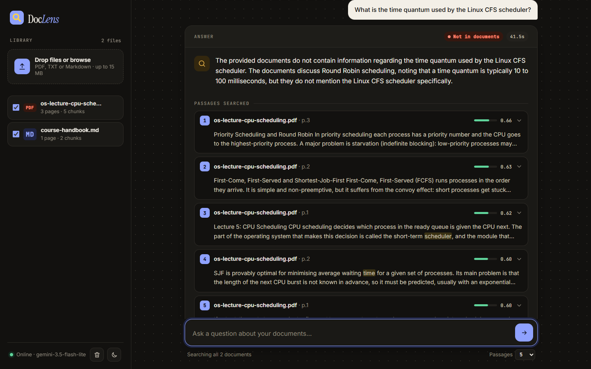

# Level 2 — DocLens: Ask Questions About Your Documents

Upload PDF, TXT or Markdown files and ask questions about them. DocLens finds the passages
that relate to your question, answers using only those passages, and shows you exactly which
passage (file and page) supports each sentence.



| Library with sample documents | Question the documents don't cover (dark mode) |
|---|---|
|  |  |

---

## Run it

```bash
cd level2-doc-qa
python -m venv .venv
.venv\Scripts\activate            # macOS/Linux: source .venv/bin/activate
pip install -r requirements.txt
copy .env.example .env            # macOS/Linux: cp .env.example .env — then add GEMINI_API_KEY
uvicorn app.main:app --port 8002
```

Open http://localhost:8002 and click **Load sample documents** to try it straight away. The
samples are an operating-systems lecture PDF and a course handbook in Markdown. The API docs
are at http://localhost:8002/docs.

```bash
pytest -q        # 12 tests; Gemini is mocked, so no key or network is needed
```

---

## How it works

```
 UPLOAD                                            ASK
 ──────                                            ───
 file ─► validate type/size/duplicate              question ─► validate
      ─► extract text page by page                         ─► embed (RETRIEVAL_QUERY)
      ─► clean (unwrap lines, strip Markdown)              ─► cosine similarity vs every chunk
      ─► split into ~900-char chunks                       ─► keep top-k, optionally only
      ─► embed chunks (RETRIEVAL_DOCUMENT)                    from the selected documents
      ─► add to vector store (saved to data/)              ─► drop chunks below MIN_SCORE
                                                           ─► nothing left? answer "not found"
                                                              without calling the LLM
                                                           ─► LLM answers from numbered
                                                              passages, with [n] citations
                                                           ─► check citations, set confidence
                                                           ─► answer + sources to the UI
```

| File | Responsibility |
|---|---|
| `app/ingest.py` | File validation, PDF/TXT/MD text extraction, cleaning, chunking |
| `app/llm.py` | Gemini embeddings (batched, normalised) and structured generation with retries/fallback |
| `app/store.py` | Vector store: one NumPy matrix of embeddings + chunk metadata, saved to disk |
| `app/qa.py` | Retrieval, relevance threshold, grounded prompt, citation post-checks |
| `app/main.py` | FastAPI routes and error handling; serves the UI |
| `static/` | The web UI (plain HTML/CSS/JS) |

### API

| Method | Path | Purpose |
|---|---|---|
| `POST` | `/api/documents` | Upload and index one file (multipart `file`) |
| `GET` | `/api/documents` | List indexed documents |
| `DELETE` | `/api/documents/{id}` · `/api/documents` | Remove one or all documents |
| `POST` | `/api/samples` | Index the bundled sample documents |
| `POST` | `/api/ask` | `{question, document_ids?, top_k}` → answer, confidence, sources with scores |

---

## Design decisions

### Text extraction
- **PDF**: `pypdf`, page by page, so every chunk keeps its page number for citations. A PDF with no text
  layer (a scanned image) gets a clear "run OCR first" message instead of being indexed empty.
- **TXT**: decoded as UTF-8, then UTF-16 and Windows-1252 as fallbacks. Binary files are rejected.
- **Markdown**: headings, links, emphasis and image syntax are stripped so only the readable text is embedded.
- **Cleaning**: lines wrapped mid-sentence (common in PDFs) are joined back up, words hyphenated across
  lines are repaired, and extra whitespace is removed.

### Chunk size: ~900 characters with ~150 characters of overlap
- Text is split into **sentences**, which are packed into chunks of at most `CHUNK_SIZE` characters. A
  chunk never ends mid-sentence.
- **~900 characters (about 200 tokens, 1–2 paragraphs)** is small enough that a chunk is about one idea,
  which keeps similarity scores sharp and citations precise. It is also large enough to keep the
  sentence that gives a fact its context.
- **Overlap**: the last ~150 characters (whole sentences) of each chunk are repeated at the start of the
  next, so a fact that falls on a boundary is still complete in at least one chunk.
- Chunks don't cross page boundaries (each citation points to one page), and a tiny leftover at the end
  of a page is merged into the previous chunk.
- With `top_k = 5`, the model receives about 4,500 characters of context: enough to answer, and cheap and
  fast to send.

### Embeddings and search
- **Model**: `gemini-embedding-001`, reduced to **768 dimensions** (a quarter of the full size, with
  little loss in quality).
- **Asymmetric task types**: chunks are embedded as `RETRIEVAL_DOCUMENT` and questions as
  `RETRIEVAL_QUERY`. This helps a short question match a longer passage that answers it.
- **Normalisation**: vectors are L2-normalised, so cosine similarity is a dot product. A search is one
  matrix-vector multiplication over all chunks. This is exact, and it takes well under a millisecond for
  thousands of chunks, so an approximate index such as FAISS isn't needed at this scale (Level 3 uses one).
- **Document scope**: unticking a file in the library excludes its chunks from the search.
- **Persistence**: the matrix is saved as `.npy` and the metadata as JSON in `data/`, so the library
  survives a restart.

### Keeping answers grounded
1. **Relevance threshold** (`MIN_SCORE = 0.55`): chunks scoring below it are discarded. If none remain,
   DocLens replies "not found" **without calling the LLM**, so the model never gets the chance to answer
   from its own memory. In testing, off-topic questions scored ≤ 0.45 and real matches 0.60–0.70.
2. **Strict prompt**: the model may only use the numbered passages, must cite one after every factual
   sentence, must set `found=false` when the passages don't contain the answer (*even if it knows the
   answer*), must point out when sources disagree, and must ignore instructions inside documents.
3. **Structured output**: Gemini returns JSON (`found`, `answer`, `cited`, `confidence`) that is validated
   with Pydantic, so the app can act on it instead of parsing free text.
4. **Post-checks**: citations to passages that don't exist (e.g. `[9]` when there are 5) are removed. An
   answer with no valid citation is downgraded to low confidence. A borderline best retrieval score caps
   confidence at medium. A "not found" answer never marks sources as cited.
5. **Transparency**: every answer shows the passages used, with file, page, similarity score and
   highlighted matching words. Citation chips in the answer jump to their passage.

Example from testing: *"What is the time quantum used by the Linux CFS scheduler?"* retrieves relevant
scheduling passages (scores ~0.6), but they never mention CFS. The model correctly answers that the
documents don't cover it, instead of supplying the answer from general knowledge.

### Error handling

| Situation | Response |
|---|---|
| Unsupported type, empty file, > 15 MB, corrupted or password-protected PDF, scanned PDF | `422`/`413` with a specific message, shown on the upload card |
| Same file uploaded twice | `409`: "already indexed as …" (SHA-256 of the content) |
| Empty or nonsense question, no documents, no documents selected | Caught in the UI and again by the API |
| Gemini 503/429/timeout | Retry with backoff, then fall back to other models |
| Embedding batch > 100 texts | Split into batches automatically (API limit) |
| Server unreachable | Error card with **Try again** |

## Configuration

| Variable | Default | Meaning |
|---|---|---|
| `GEMINI_API_KEY` | — | Required |
| `GEMINI_MODEL` / `GEMINI_FALLBACK_MODELS` | `gemini-3.5-flash-lite` / `gemini-3.1-flash-lite,gemini-3.5-flash` | Answer generation |
| `EMBEDDING_MODEL` / `EMBEDDING_DIM` | `gemini-embedding-001` / `768` | Embeddings |
| `CHUNK_SIZE` / `CHUNK_OVERLAP` | `900` / `150` | Characters per chunk / overlap |
| `TOP_K` / `MIN_SCORE` | `5` / `0.55` | Passages retrieved / relevance threshold |
| `REQUEST_TIMEOUT_S` | `25` | Per-request timeout before retrying or falling back |
