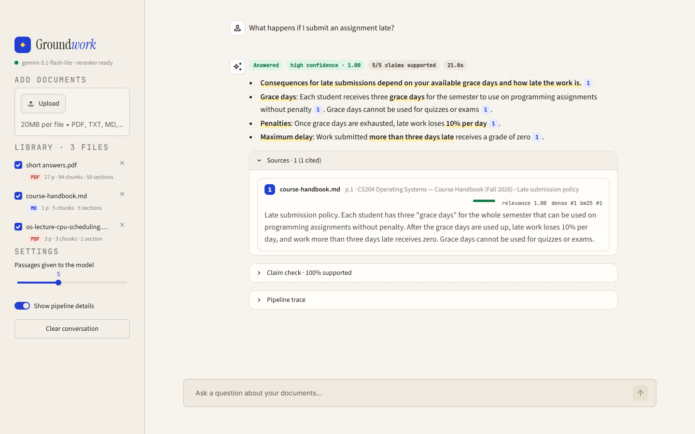
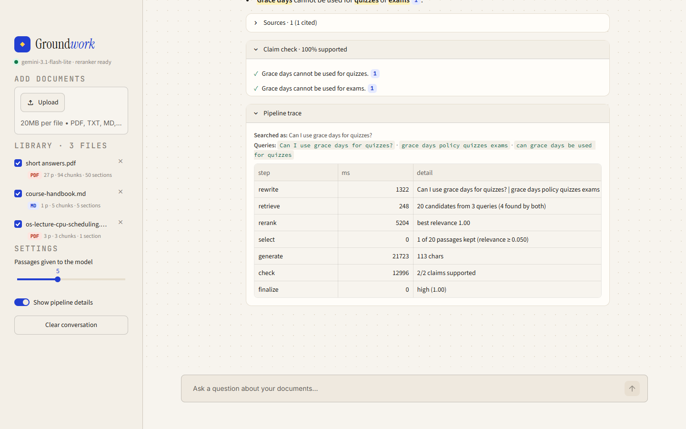
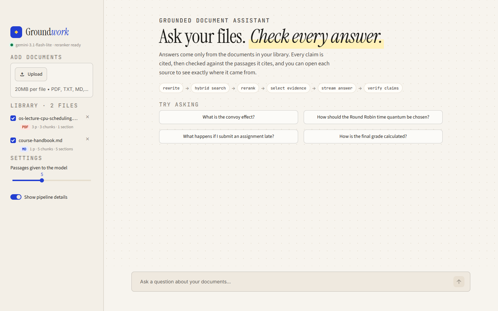

# Level 3 — Groundwork: Production-style RAG Assistant

Grounded question answering over PDF, TXT and Markdown files. A **FastAPI** backend runs a
**LangGraph** workflow:

1. Rewrite the question (only for follow-ups).
2. Hybrid search: **FAISS** + BM25.
3. Rerank with a cross-encoder.
4. Select evidence.
5. Stream a cited answer.
6. Check each claim against the sources, and revise if needed.

A **Streamlit** UI shows every step, and the whole system runs with **Docker Compose**.



| Follow-up resolved from history, claim check and pipeline trace | Home |
|---|---|
|  |  |

---

## Quick start

### Docker (recommended)

```bash
cd level3-rag-assistant
cp .env.example .env        # add GEMINI_API_KEY
docker compose up --build
```

UI: http://localhost:8501 · API docs: http://localhost:8000/docs

### Without Docker

```bash
cd level3-rag-assistant
python -m venv .venv && .venv\Scripts\activate
pip install -r backend/requirements-dev.txt -r frontend/requirements.txt
copy .env.example .env      # add GEMINI_API_KEY

cd backend  && uvicorn app.main:app --port 8003          # terminal 1
cd frontend && streamlit run app.py                      # terminal 2 (BACKEND_URL defaults to :8003)
```

Click **Load sample documents** in the sidebar to try it right away.

```bash
cd backend && pytest -q      # 34 tests, Gemini and the reranker are faked: no key or network needed
```

---

## Architecture

```
┌──────────────── Streamlit UI (frontend/) ────────────────┐
│ library + upload progress · streaming chat · citations │
│ source cards · claim check · pipeline trace            │
└───────────────┬──────────────────────────────────────────┘
                │ REST + Server-Sent Events
┌───────────────▼───────────── FastAPI (backend/app/) ─────────────────────────────┐
│ api/          routes, request validation, error → {"error": "..."} mapping       │
│ services/     DocumentService: background ingest jobs with progress              │
│ ingestion/    parsers (PDF/TXT/MD, sections, header/footer removal) · chunking   │
│ retrieval/    embeddings (Gemini or local) · FAISS store · BM25 · RRF · reranker │
│ generation/   Gemini client · hedged structured + streaming calls · prompts      │
│ graph/        LangGraph pipeline (below)                                         │
│ core/         typed settings (pydantic-settings)                                 │
│ schemas.py    Pydantic models shared by API, pipeline and UI                     │
└──────────────────────────────────────────────────────────────────────────────────┘
```

Ingestion, retrieval and generation are separate packages with narrow interfaces. The pipeline
only talks to `VectorStore`, `KeywordIndex`, `embed()`, `reranker.score()` and the two LLM
functions, so any of them can be swapped (and are, in the tests) without touching the others.

### The LangGraph workflow

```
rewrite ─► retrieve ─► rerank ─► select ─┬─► generate ─► check ─┬─► finalize ─► END
                                         │                ▲     │
                                         │                └─ revise (max 1)
                                         └─► no_answer ─────────► finalize
```

| Node | What it does | Why |
|---|---|---|
| **rewrite** | With chat history, an LLM turns the message into a standalone question plus 2–3 search queries ("Can I use *them* for quizzes?" → "Can I use *grace days* for quizzes?"). Without history it is skipped. | Follow-ups are unsearchable as written. Skipping it for first questions saves an LLM call and embedding quota, since hybrid search already covers paraphrases. If rewriting fails, the original question is used. |
| **retrieve** | Every query goes to FAISS (dense, top 20) and BM25 (keyword, top 20). Results are fused with Reciprocal Rank Fusion into a pool of 20. | Dense search finds meaning; BM25 finds exact tokens such as acronyms ("DORA"), file names ("Jenkinsfile") and numbers. RRF merges the two incomparable score scales using ranks only. |
| **rerank** | A cross-encoder (`ms-marco-MiniLM-L-6-v2`, ONNX via fastembed, about 80 MB, local) scores each (question, passage) pair from 0 to 1. | A cross-encoder reads question and passage *together*: far more precise than vector similarity, and affordable on 20 candidates. It runs locally, so there are no API calls or quota. |
| **select** | Keeps passages scoring at least `max(0.02, 5% of the best)`, up to `top_k`. | Context filtering: weak passages are dropped instead of padding the prompt. In testing, right passages scored 0.88–1.00 and wrong ones 0.0001–0.005. |
| **no_answer** | Reached when nothing passes `select`. | The generator is **never called** without evidence, so it cannot answer from memory. |
| **generate** | Streams a Markdown answer with `[n]` after every factual sentence, using only the numbered passages. The model may reply `NOT_FOUND:`. | Citations make every claim checkable. Streaming shows text as soon as the first token arrives. |
| **check** | Deterministic checks (citations to passages that don't exist, sentences without citations), then an LLM audit that splits the answer into claims and marks each as supported or not by its cited passages. | Measures groundedness instead of assuming it. |
| **revise** | If fewer than 75% of claims are supported, the answer is rewritten once with the unsupported claims listed, then checked again. | Self-correction with a hard limit, so it can't loop. |
| **finalize** | Marks cited sources and computes confidence = 0.6 × groundedness + 0.4 × retrieval strength. A revised answer is capped at "medium"; an answer without citations is capped at 0.3. | One honest signal for the UI, built from the measured parts. |

Each node is wrapped by a decorator that times it, appends a `TraceStep`, and emits start/end events
through LangGraph's stream writer. The UI turns those into the live status line and the trace table.

---

## Retrieval quality

- **Section-aware chunking.** Parsers detect structure: Markdown headings (kept as a path,
  "Handbook › Late policy") and numbered headings in PDFs/TXT ("Q8.", "Unit III", "2.1 Title").
  Chunks are about 1,200 characters, built from whole sentences, with about 200 characters of overlap,
  and **never cross a page or section boundary**, so a citation always points to one page and one
  section.
- **Contextual chunk headers.** Each chunk is embedded as `Document: … | Section: …` followed by its
  text, but stored and shown without the header. A passage that starts "It has three stages…" still
  matches a question about the section's topic.
- **Running header and footer removal.** Lines that repeat at the top or bottom of most PDF pages
  (course title, "Page 7") are removed before chunking, so they don't add noise to every vector.
- **Asymmetric embeddings.** Chunks use `RETRIEVAL_DOCUMENT` and questions use `RETRIEVAL_QUERY`
  (Gemini). The local bge model uses its query instruction prefix.
- **Document-scoped search.** FAISS `IDSelectorBatch` restricts the search to the selected documents'
  chunk ids *inside* the index scan, so a filtered search still returns a full top-k.

## How hallucinations are reduced

1. No relevant evidence means no generation: the `select` → `no_answer` route.
2. The prompt forbids outside knowledge, requires a citation after every factual sentence, offers an
   explicit `NOT_FOUND` exit, and treats document text as untrusted data (prompt-injection guard).
3. Citations are validated: references to passages that don't exist cap the groundedness score.
4. A claim-level LLM audit, plus one constrained revision when claims are unsupported.
5. Everything is visible: confidence, claims supported (e.g. 5/5), each source with page, section,
   reranker relevance and dense/BM25 ranks, and the full trace.

## Reliability and production details

- **Typed everywhere.** Pydantic request and response models with validators (empty or nonsense
  questions, length limits, a bounded `top_k`). `pydantic-settings` validates configuration at
  startup; for example, `chunk_overlap` must be smaller than `chunk_size`.
- **Hedged LLM calls.** Free-tier models are sometimes overloaded for minutes. Each call starts on the
  preferred model; after 6 s without a response, or on failure, the next model is started too, and the
  first valid result wins. For streaming, the race is decided by the *first token*. There is a hard
  overall deadline, so a hung model produces a clear error instead of an endless spinner (covered by
  `tests/test_llm.py`). The SDK's hidden retry layer is disabled.
- **Embedding quotas.** The Gemini free tier allows 100 embedded texts per minute and 1,000 per day. A
  sliding-window rate limiter waits *before* sending. Questions get reserved slots so they never queue
  behind an upload. A 429 waits for the API's `retryDelay`. Reaching the *daily* cap fails immediately
  with a clear message.
- **Local embedding option.** `EMBEDDING_PROVIDER=local` switches to `BAAI/bge-small-en-v1.5` (384-d,
  ONNX, runs on the CPU): no quota and no network for indexing. A 27-page PDF (94 chunks) indexes in
  about 11 s. The index records which embedding model built it and refuses to mix vector spaces.
- **Background ingestion.** Uploads return `202` with a job id. `/api/jobs/{id}` reports stage,
  progress (`64/94`) and rate-limit waits. Duplicate files are rejected by SHA-256.
- **Persistence.** The FAISS index (`index.faiss`) and metadata (`meta.json`) are written atomically
  (temp file, then rename) to a Docker volume.
- **Containers.** Slim Python 3.12 images run as a non-root user and have health checks. The reranker
  model is downloaded **at build time**, so the backend starts instantly and works offline. The
  frontend waits for the backend to be healthy before starting.
- **Observability.** Request logs carry an id and duration (`X-Request-ID` header). `/api/health` reports
  model, reranker and index status; `/api/config` shows the effective retrieval settings.

## Streaming protocol (`POST /api/chat/stream`, Server-Sent Events)

| Event | Payload |
|---|---|
| `step` | `{node, status: start/end, ms, detail}` for each pipeline node |
| `sources` | Selected passages (before generation starts) |
| `token` | A piece of the answer text |
| `check` | Groundedness: score, per-claim verdicts, citation problems |
| `revision` | The corrected answer, replacing the streamed one |
| `done` | The final `ChatResponse` (same shape as `POST /api/chat`) |
| `error` | `{error}`: a readable message |

## API

| Method | Path | Purpose |
|---|---|---|
| `POST` | `/api/documents` | Upload a file → `202` + ingest job |
| `GET` | `/api/jobs/{id}` | Ingest progress / result / error |
| `GET` / `DELETE` | `/api/documents`, `/api/documents/{id}` | List / remove documents |
| `POST` | `/api/samples` | Index the bundled sample documents |
| `POST` | `/api/chat` | Answer as a single JSON `ChatResponse` |
| `POST` | `/api/chat/stream` | Answer as Server-Sent Events |
| `GET` | `/api/health`, `/api/config` | Status and effective settings |

## Configuration (`.env`)

| Variable | Default | Meaning |
|---|---|---|
| `GEMINI_API_KEY` | — | Required |
| `GEMINI_MODEL` / `GEMINI_FALLBACK_MODELS` | `gemini-3.1-flash-lite` / `gemini-3.5-flash-lite,gemini-3.5-flash` | Generation, in order of preference |
| `HEDGE_AFTER_S` | `6` | Seconds before a backup model is also asked |
| `EMBEDDING_PROVIDER` | `gemini` | `gemini` or `local` |
| `EMBEDDING_MODEL` / `EMBEDDING_DIM` | `gemini-embedding-001` / `768` | Gemini embeddings |
| `CHUNK_SIZE` / `CHUNK_OVERLAP` | `1200` / `200` | Characters |
| `TOP_K` | `5` | Maximum passages given to the generator |
| `RERANK_MIN_SCORE` | `0.02` | Absolute relevance floor (0–1) |
| `GROUNDEDNESS_THRESHOLD` | `0.75` | Below this share of supported claims, revise once |

## Tests

34 tests covering:
- parsing (sections, headers, bad files)
- chunking (boundaries, overlap)
- FAISS (scoped search, removal, persistence, refusing an index built by a different model)
- BM25 and RRF fusion
- the rate limiter
- every pipeline route: answered, follow-up rewrite, rewrite failure fallback, no evidence → no
  generation, model `NOT_FOUND`, unsupported claims → revision, invalid citations
- SSE event order
- API validation and errors
- hedged generation, including a hung model

## Notes

- `faiss-cpu` is pinned to 1.11.0: newer Windows wheels were blocked by Windows Smart App Control on
  the development machine. Linux (Docker) is unaffected.
- On the free tier, generation latency varies a lot with Google's load (2–30 s). Hedging keeps
  the worst case bounded, and streaming shows text as soon as it starts arriving.
